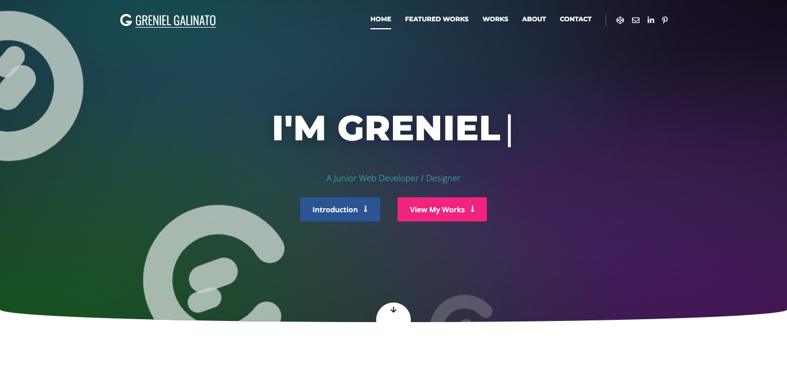

# grenielgalinato.com (2021 portfolio, rebuilt)

My first portfolio site. The original was made in WordPress in 2021, and the theme files and database are gone. All I had left was a PDF printout of the homepage, so I rebuilt the whole page by hand in plain HTML, CSS and JavaScript: same layout, same sections, same text, and the same works.

**Year:** 2021 (rebuilt without WordPress) · **Type:** Single page · **Built with:** HTML, CSS Grid, CSS custom properties, JavaScript (ES2020, IntersectionObserver), Font Awesome 5

## Sections
- **Hero** - gradient background with the big "G" shapes, "I'M GRENIEL |" with a typing effect, Introduction and View My Works buttons
- **Greniel Portfolio** - welcome text and my 3 principles: Professionalism, Honesty, Integrity
- **Quote** - Marcus Aurelius, over a pattern of icons
- **Website Designs** - 8 screenshots of web pages I coded
- **CodePen** - where some of those projects live
- **Website Project Sample** - Figma wireframes for Arat (travel company) and Paper Bags Themes (WordPress theme shop)
- **Apps Project Sample** - Sketch wireframes and final designs for a task manager, a personal blog app, and a notes app
- **Digital Hand Drawn Designs** - 10 illustrations drawn on a tablet and finished in Illustrator
- **Poster & Layout Designs** - 6 posters
- **Social media**, **Other Works & Web Designs** gallery, **About Me & Skills**, **Contact Me!**, and the footer

## Features
- Every image opens in a lightbox. Images in the same group (like an app's wireframe and final design) can be browsed with arrows or the arrow keys, and Esc closes it
- The two long one-page screenshots scroll inside their frame on hover, so you can see the whole page without opening it
- "Other Works" tiles open the whole category as one gallery
- Typing effect in the hero without a plugin (respects `prefers-reduced-motion`)
- Skill bars fill up and the projects counter counts up when you scroll to them
- Header turns solid after you scroll, menu items follow the section on screen, hamburger menu on mobile
- The icon pattern in the dark sections is generated by JavaScript, so it's one empty `
` in the HTML
- The contact form validates, then opens your email app with the message filled in, since a static site has no backend
- The Arat and Paper Bags wireframes link to the HTML versions I built later: [66-arat](../66-arat/) and [67-paper-bags-themes](../67-paper-bags-themes/)

## What I learned
- Rebuilding from a screenshot is a good test: you have to guess the font sizes, spacing and colors, then compare side by side until it matches
- One SVG `<symbol>` for the "G" logo, reused with `<use>` in the header, the footer, the hero shapes, and the icon pattern
- The curved bottom of the hero is just `border-radius` with different horizontal and vertical radii (`0 0 50% 50% / 0 0 22px 22px`)
- Skill bars with a CSS variable per bar (`--value`, `--color`) and one transition that runs when a `.visible` class is added
- A page builder hides a lot from you. Doing this by hand made me see how much of the old site was repeated wrappers

## Changes from the original
- The street address and phone number from the old footer are left out. Only the city and email are shown
- The counter said "24%", which was a typo in the WordPress widget. It now says "24+"
- The "Figma Project Link" buttons now point to the HTML versions, since I don't have the old Figma share links
- Social links point to the main sites for now, until I add my profile URLs

## Images
All images in `img/` are my own work and photos, cut out of the PDF printout of the old site, so some of them are lower resolution than the originals.

## How to run
Open `index.html` in a browser. Fonts and icons load from Google Fonts and cdnjs.
